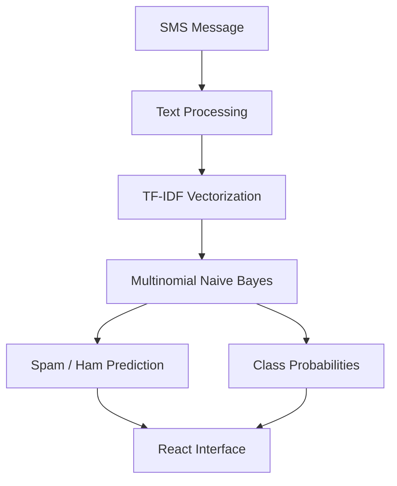
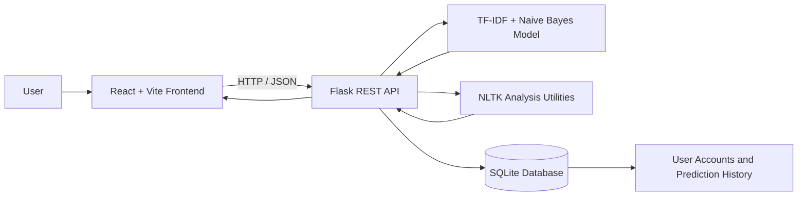

# SMS Spam Detection Using NLP & Machine Learning

<p align="center">
  A full-stack web application for detecting SMS spam using Natural Language Processing and supervised Machine Learning.
</p>

<p align="center">
  
  
  
  
  
  
  
  
</p>

---

## Overview

SMS Spam Detection is a full-stack NLP application that classifies text messages as **Spam** or **Ham (Not Spam)** using a TF-IDF feature extraction pipeline and a Multinomial Naive Bayes classifier.

The application combines machine learning with an interactive React interface and a Python Flask backend. Users can analyse messages, inspect linguistic features, compare text similarity, review model evaluation metrics, and manage their own prediction history through an authentication system.

The project is designed to demonstrate the practical integration of Natural Language Processing, machine learning, REST APIs, frontend development, database management, and application security.

## Key Features

### SMS Classification
- Predict whether a message is Spam or Ham.
- Display model prediction probabilities.
- Highlight relevant message keywords and rule-based spam indicators.
- View message statistics and classification results.

### NLP Analysis
- Text tokenization and stopword identification.
- Word, character, sentence, digit, and uppercase statistics.
- Stemming and lemmatization comparison.
- Part-of-Speech (POS) tagging using Penn Treebank tags.
- Word-frequency analysis and word cloud generation.
- TF-IDF cosine similarity comparison between two messages.

### Model Evaluation
- Accuracy, precision, recall, and F1-score.
- Confusion matrix visualization.
- Class distribution and model evaluation information.
- Display of features associated with spam predictions.

### Authentication and User Accounts
- User registration, login, and logout.
- Password hashing and session management.
- Protected application routes and API endpoints.
- Password-reset workflow for local development.
- User-specific prediction history with filtering and deletion.
- Privacy preference controlling whether full message text is retained.

### User Experience
- Responsive React interface.
- Dark and light themes.
- Sample messages for quick testing.
- Loading and error states.
- Account and session controls.

---

## Model Performance

The following results were reported for the project's held-out test set. Confirm them against the current saved evaluation metrics before using them as final benchmark results.

| Metric | Reported result |
|---|---:|
| Accuracy | 98.39% |
| Precision | 97.81% |
| Recall | 89.93% |
| F1-score | 93.71% |
| Test samples | 1,115 |

### Confusion Matrix

| Actual class | Predicted Ham | Predicted Spam |
|---|---:|---:|
| Ham | 963 | 3 |
| Spam | 15 | 134 |

The results indicate strong overall classification performance. However, some spam messages are incorrectly classified as legitimate, so the prediction should not be treated as a guarantee that a message is safe.

---

## Machine Learning and NLP Architecture

### Dataset

The project uses the **SMS Spam Collection** dataset.

| Dataset property | Value |
|---|---:|
| Total messages | 5,574 |
| Ham messages | 4,827 |
| Spam messages | 747 |
| Training split | 80% |
| Test split | 20% |
| Split strategy | Stratified |

The dataset contains labelled SMS messages used to train and evaluate the binary classification model.

### Classification Pipeline



### Feature Extraction

The application uses TF-IDF (Term Frequency–Inverse Document Frequency) to represent text numerically.

The reported configuration includes:

- Unigrams and bigrams
- Maximum of 5,000 features
- `sublinear_tf=True`

Unigrams represent individual terms, while bigrams represent two-term sequences. These features help the model learn patterns associated with spam and legitimate messages.

### Classification Algorithm

The classifier is **Multinomial Naive Bayes**, a probabilistic machine learning algorithm commonly used for text classification.

The reported configuration is:

```python
MultinomialNB(alpha=0.2)
```

The trained pipeline is stored in:

```text
backend/model/spam_detector_pipeline.joblib
```

The application loads this model for predictions rather than retraining it for every request.

### Supporting NLP Techniques

The application also uses NLTK and related utilities for tokenization, stopword analysis, stemming, lemmatization, POS tagging, and word-frequency analysis. TF-IDF vectors are used for text similarity calculations.

---

## Application Architecture



### Technology Stack

| Component | Technology |
|---|---|
| Frontend | React, JavaScript, Vite |
| Routing and UI | React Router, Recharts, Lucide icons |
| Backend | Python, Flask |
| API | REST endpoints using JSON |
| NLP | NLTK |
| Feature extraction | scikit-learn TF-IDF |
| Classification | Multinomial Naive Bayes |
| Database | SQLite |
| Password security | Werkzeug password hashing |
| Testing | pytest |
| Deployment configuration | Render |

---

## Authentication and Privacy

### User Accounts

The application supports account registration, login, logout, and session-based authentication. Passwords are stored as secure hashes rather than plaintext values.

Protected API endpoints require an authenticated session. State-changing requests use a session-bound CSRF token.

### Database Structure

The SQLite database manages two principal types of records:

- **Users:** account identifiers, email addresses, password hashes, preferences, and password-reset information.
- **Prediction history:** classification results, timestamps, and message previews associated with individual users.

The local database is generated automatically when the backend initializes.

### Privacy Controls

- Prediction history is isolated by user account.
- Message previews are limited to 80 characters by default.
- Full message text is retained only when the user explicitly enables the corresponding preference.
- Users can delete individual history entries or clear their history.

**Note:** Local development password recovery uses a development token flow. Real password-reset email delivery requires an appropriately configured email service. Do not expose development reset tokens in production.

---

## Project Structure

```text
SMS-Spam-Detector-NLP/
├── README.md
├── LICENSE
├── .gitignore
├── .env.example
├── render.yaml
│
├── backend/
│   ├── app.py
│   ├── auth.py
│   ├── db.py
│   ├── download_nltk.py
│   ├── requirements.txt
│   ├── data/
│   │   └── SMSSpamCollection
│   ├── model/
│   │   └── spam_detector_pipeline.joblib
│   ├── nlp/
│   │   ├── classifier.py
│   │   ├── processor.py
│   │   └── samples.py
│   └── tests/
│       ├── test_api.py
│       └── test_auth.py
│
└── frontend/
    ├── index.html
    ├── package.json
    ├── vite.config.js
    └── src/
        ├── App.jsx
        ├── AuthContext.jsx
        ├── AppState.jsx
        ├── api.js
        ├── index.css
        ├── components/
        └── pages/
```

This is a high-level overview. Individual files may differ as the project evolves.

---

## Local Installation and Setup

### Prerequisites

Install the following:

- Python 3.10 or later
- Node.js 18 or later
- npm
- Git

### 1. Clone the Repository

Replace the URL below with your actual GitHub repository URL after publishing.

```bash
git clone https://github.com/YOUR_USERNAME/SMS-Spam-Detector-NLP.git
cd SMS-Spam-Detector-NLP
```

### 2. Set Up the Backend

```bash
cd backend

python3 -m venv .venv
source .venv/bin/activate
```

On Windows, activate the virtual environment with:

```powershell
.venv\Scripts\Activate.ps1
```

Install the dependencies:

```bash
python -m pip install -r requirements.txt
```

Download the required NLTK resources using the project's helper script:

```bash
python download_nltk.py
```

If the helper script has a different name in your checkout, use the actual script present in the `backend` directory.

Configure the environment variables as needed, then start Flask:

```bash
python app.py
```

The backend normally runs at:

```text
http://127.0.0.1:5000
```

### 3. Set Up the Frontend

Open a second terminal at the repository root:

```bash
cd frontend
npm install
npm run dev
```

Vite normally serves the frontend at:

```text
http://localhost:5173
```

Open that address in your browser.

### 4. Create an Account

Register through the Signup page, log in, and start analysing SMS messages. The development-only demo access option, if available, is intended for local testing.

---

## Environment Variables

Use `.env.example` as the configuration template and supply appropriate values for your environment.

| Variable | Purpose |
|---|---|
| `FLASK_ENV` | Indicates the intended runtime environment. |
| `SECRET_KEY` | Secret used to sign Flask session cookies. |
| `CORS_ORIGINS` | Allowed frontend origins for cross-origin requests. |
| `COOKIE_SECURE` | Enables secure-only session cookies when set to `true`. |
| `DATABASE_PATH` | Optional path to the SQLite database. |
| `VITE_API_BASE_URL` | Backend API base URL used by the frontend build. |

Do not commit real secrets or local `.env` files to GitHub. Use a strong, private `SECRET_KEY` for deployment, and configure HTTPS and secure cookies in production.

---

## API Reference

The following is a summary of the documented API surface. Refer to the current backend implementation for exact request schemas and response formats.

### Public Endpoints

| Method | Endpoint | Purpose |
|---|---|---|
| `GET` | `/api/health` | Checks backend health and model readiness. |
| `GET` | `/api/model/metrics` | Returns model evaluation metrics. |
| `GET` | `/api/samples` | Returns example SMS messages. |
| `GET` | `/api/samples/<id>` | Retrieves a sample message. |
| `GET` | `/api/auth/csrf` | Initializes or retrieves a CSRF token. |
| `POST` | `/api/auth/register` | Registers a user account. |
| `POST` | `/api/auth/login` | Authenticates a user. |
| `POST` | `/api/auth/forgot-password` | Starts the password-recovery workflow. |
| `POST` | `/api/auth/reset-password` | Resets a password using a valid token. |

### Authenticated Endpoints

| Method | Endpoint | Purpose |
|---|---|---|
| `GET` | `/api/auth/me` | Returns the current user's session and profile. |
| `POST` | `/api/auth/logout` | Ends the current session. |
| `PATCH` | `/api/auth/preferences` | Updates user preferences. |
| `POST` | `/api/predict` | Classifies an SMS message. |
| `POST` | `/api/analyze` | Performs linguistic and message analysis. |
| `POST` | `/api/similarity` | Compares two text messages. |
| `POST` | `/api/wordcloud` | Generates a word cloud. |
| `GET` | `/api/history` | Retrieves the current user's history. |
| `DELETE` | `/api/history` | Clears the current user's history. |
| `DELETE` | `/api/history/<id>` | Deletes an individual history item. |

Authenticated requests use the session cookie. Requests that modify state must also provide the required CSRF token.

### Example Prediction Request

```http
POST /api/predict
Content-Type: application/json
```

```json
{
  "text": "Congratulations! You have won a prize. Call now to claim."
}
```

The response contains the predicted class and the supported prediction details. Exact response fields should be checked against the current API implementation.

---

## Automated Testing

The project includes backend tests for classification, NLP utilities, API validation, authentication, CSRF protection, password reset, and user-data isolation.

### Run Backend Tests

From the repository root:

```bash
cd backend
source .venv/bin/activate
python -m pytest tests/ -v
```

### Build the Frontend

From the repository root:

```bash
cd frontend
npm run build
```

The reported verification run completed with **51 backend tests passing** and a successful frontend production build. Run both commands again after making changes to confirm the current state.

---

## Deployment

The repository includes a `render.yaml` configuration intended to support deployment on Render.

General deployment workflow:

1. Push the repository to GitHub.
2. Open the Render dashboard.
3. Select **New → Blueprint**.
4. Connect the GitHub repository and review the detected services.
5. Configure required environment variables, including a strong secret key and the correct frontend origin.
6. Deploy and verify the frontend, API health endpoint, authentication, and prediction workflows.

### Important Deployment Considerations

- **Database persistence:** SQLite data can be lost when hosted on an ephemeral filesystem. Use persistent storage or a managed database if accounts and prediction history must survive restarts and redeployments.
- **Cold starts:** Free hosting services may suspend inactive instances, causing delays on the first request.
- **Password recovery:** Production password-reset emails require a configured email-delivery service.
- **CORS and cookies:** Configure the correct production origins, HTTPS, and secure cookie settings.
- **Model and NLP resources:** Ensure the model artifact and required NLTK resources are available during deployment.

The presence of deployment configuration does not by itself guarantee a successful deployment. Test the live application after deployment.

---

## Limitations

- The classifier is trained on a particular labelled SMS dataset and may perform differently on newer or differently worded messages.
- Some spam messages may be missed, and legitimate messages may be incorrectly flagged.
- Rule-based risk indicators are supplementary signals and are not proof that a message is malicious.
- The current model is designed for the dataset's supported language and classification task.
- Prediction probabilities are model estimates, not guarantees of correctness.
- Persistent account history requires suitable database storage in a deployed environment.

---

## Future Scope

- Evaluate multilingual SMS classification.
- Compare the current model with more advanced text-classification approaches.
- Expand and periodically update the training dataset.
- Improve explanations of classification results.
- Add further evaluation and monitoring for changing spam patterns.
- Integrate a persistent managed database for deployed accounts and history.

---

## References

1. T. A. Almeida, J. M. G. Hidalgo, and A. Yamakami, “Contributions to the Study of SMS Spam Filtering: New Collection and Results,” *Proceedings of the 2011 ACM Symposium on Document Engineering*, 2011.
2. C. D. Manning, P. Raghavan, and H. Schütze, *Introduction to Information Retrieval*. Cambridge University Press, 2008.
3. S. Bird, E. Klein, and E. Loper, *Natural Language Processing with Python*. O’Reilly Media, 2009.
4. F. Pedregosa et al., “Scikit-learn: Machine Learning in Python,” *Journal of Machine Learning Research*, vol. 12, pp. 2825–2830, 2011.
5. [NLTK Documentation](https://www.nltk.org/)
6. [scikit-learn Documentation](https://scikit-learn.org/stable/)
7. [SMS Spam Collection Dataset](https://archive.ics.uci.edu/dataset/228/sms+spam+collection)

---

## License

This project is distributed under the MIT License. See the [LICENSE](LICENSE) file for details.